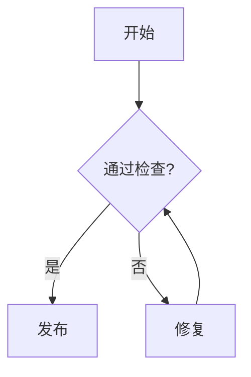

# Mermaid to TikZ Reference

Mermaid 转换是语义工作，不由正则脚本完成。始终在临时 Markdown 副本中转换，保留
原文件不变。转换后先检查节点、边、方向和标签，再运行 renderer。

## 通用规则

- `flowchart TD/TB` 主轴使用 `below=of`；`LR` 使用 `right=of`。
- 普通节点使用 `box`，判断节点使用 `decision`，箭头使用 `arrow`。
- 使用模板颜色 `tikzboxfill`、`tikzboxstroke`、`tikzaccent`、`tikzaccept`、
  `tikzreject`、`tikzdecision`。
- 中文可直接写入节点。标签中的 `%`、`&`、`#`、`_`、`$`、`{`、`}` 必须按
  LaTeX 规则转义；数学内容放入 `$...$`。
- 节点 ID 必须唯一且只使用 ASCII 字母、数字和短横线。
- 转换后不得遗留 `mermaid` fenced block；renderer 会拒绝这种输入。

## Flowchart

Mermaid：



TikZ：

```tikz
\begin{tikzpicture}[
  node distance=1.2cm and 1.8cm,
  box/.style={rectangle, rounded corners, draw=tikzboxstroke,
    fill=tikzboxfill, minimum width=2.2cm, minimum height=0.8cm,
    align=center, font=\sffamily\small},
  decision/.style={diamond, draw=tikzboxstroke, fill=tikzdecision,
    aspect=2, align=center, font=\sffamily\small, inner sep=1pt},
  arrow/.style={-{Stealth[length=2.5mm]}, thick, draw=tikzaccent},
  label/.style={font=\sffamily\footnotesize, fill=white, inner sep=2pt}
]
\node[box, fill=tikzaccept] (start) {开始};
\node[decision, below=of start] (check) {通过检查?};
\node[box, below left=of check] (publish) {发布};
\node[box, below right=of check] (fix) {修复};
\draw[arrow] (start) -- (check);
\draw[arrow] (check) -| node[label, pos=0.25] {是} (publish);
\draw[arrow] (check) -| node[label, pos=0.25] {否} (fix);
\draw[arrow] (fix) to[bend right=25] (check);
\end{tikzpicture}
```

形状映射：

| Mermaid | TikZ |
|---|---|
| `[text]` | `box` |
| `(text)` | `box` with rounded corners |
| `((text))` | `circle` |
| `{text}` | `decision` / `diamond` |
| `[/text/]` | `trapezium` |

## Sequence Diagram

使用顶部 actor 节点、纵向虚线 lifeline 和按 y 坐标递减排列的 message：

```tikz
\begin{tikzpicture}[
  actor/.style={rectangle, draw=tikzboxstroke, fill=tikzboxfill,
    minimum width=1.8cm, minimum height=0.7cm, font=\sffamily\small},
  lifeline/.style={dashed, draw=tikzboxstroke!50},
  msg/.style={-{Stealth[length=2mm]}, thick, draw=tikzaccent,
    font=\sffamily\footnotesize},
  reply/.style={msg, dashed}
]
\node[actor] (client) at (0,0) {Client};
\node[actor] (server) at (4,0) {Server};
\node[actor] (db) at (8,0) {DB};
\foreach \x in {0,4,8} \draw[lifeline] (\x,-0.4) -- (\x,-4.5);
\draw[msg] (0,-1) -- node[above] {GET /data} (4,-1);
\draw[msg] (4,-2) -- node[above] {SELECT *} (8,-2);
\draw[reply] (8,-3) -- node[above] {rows} (4,-3);
\draw[reply] (4,-4) -- node[above] {JSON} (0,-4);
\end{tikzpicture}
```

保持 Mermaid 中的消息顺序。同步箭头用实线，reply 用虚线；activation 可用窄矩形
覆盖 lifeline 表示。

## State Diagram

- 普通 state：圆角矩形。
- `[*]`：实心小圆；终止状态可加外圈。
- 带标签的 transition：在 `to[bend left]` 上放 `node[above]`。

```tikz
\begin{tikzpicture}[
  state/.style={rectangle, rounded corners, draw=tikzboxstroke,
    fill=tikzboxfill, minimum width=1.8cm, minimum height=0.8cm},
  initial/.style={circle, fill=black, minimum size=4mm, inner sep=0pt},
  arrow/.style={-{Stealth[length=2.5mm]}, thick, draw=tikzaccent}
]
\node[initial] (start) {};
\node[state, right=1.5cm of start] (idle) {Idle};
\node[state, right=2.5cm of idle] (running) {Running};
\draw[arrow] (start) -- (idle);
\draw[arrow] (idle) to[bend left] node[above] {start} (running);
\draw[arrow] (running) to[bend left] node[below] {stop} (idle);
\end{tikzpicture}
```

## Class Diagram

类使用一个 `align=left` 矩形，名称、字段和方法之间用横线分隔。继承箭头使用
`-{Triangle[open]}`，组合与聚合分别使用实心/空心 diamond arrow tip。长签名应手动
换行，避免节点超出页面。

## Mindmap

模板已经加载 TikZ `mindmap` library。根节点使用 `concept`，子树通过不同的模板颜色
区分。节点较多时优先减少层级或拆成多张图，而不是把 scale 降到不可读。

## 不应自动转换的类型

以下类型没有可靠的一对一转换，应停止并向用户说明：

| 类型 | 建议 |
|---|---|
| `gitgraph` | 重写为 flowchart 后再转换 |
| `journey` | 改为表格或时间线 |
| `gantt` | 需要额外 `pgfgantt` 模板依赖 |
| `pie` | 改为表格，或先明确加入 `pgf-pie` 依赖 |
| `quadrantChart` | 明确坐标后用 `pgfplots` scatter |

`erDiagram` 可以在关系和 cardinality 明确时手工转换为 class diagram；不确定时停止，
不要推断缺失关系。
