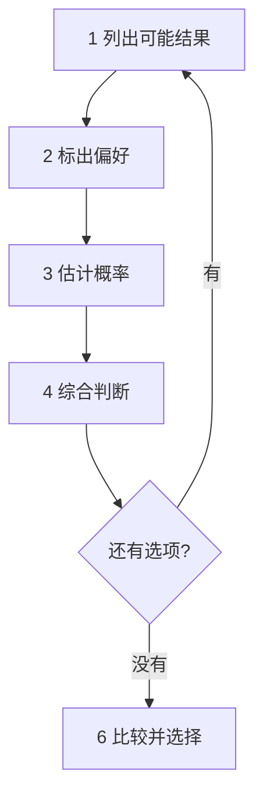

# Annie Duke 决策体系

annie-decide skill 以本文为准，两者冲突时改 skill。来源：Annie Duke《Thinking in Bets》（2018）、《How to Decide》（2020）。

> 〔AI〕全文是 AI 根据对这两本书的了解整理的学习摘要，不是原文翻译。书中的术语和步骤以原书为准；个别命名可能和原书略有出入，读原书时对照修正。

**一句话：决策就是在信息不完整时下注。要训练的是决策质量，而不是追求每次结果都好。**

Annie Duke 原本是职业扑克选手，后来研究决策科学。她的体系分成五块：

1. 核心观念：怎么看待决策和结果
2. 六步决策流程：怎么做一个决定
3. 决策前的检查：怎么减少偏差
4. 分配决策时间：哪些决定值得想，哪些该快速决定
5. 复盘和积累：怎么从结果里学

---

## 一、核心观念

### 1. 决策就是下注

每个决定都是在押注某种未来。结果由两部分决定：

- **决策质量**：你能控制的部分
- **运气**：你控制不了的部分，包括随机性，以及你当时不可能知道的信息

所以同一个决定，可能有好几种结果。你选的不是结果，而是「各种结果的概率分布」。

### 2. 不要用结果评判决策（resulting）

人习惯用结果倒推决策好坏：结果好就觉得当初决定对，结果坏就觉得决定错。Duke 把这叫作 **resulting**。

决策质量和结果好坏是两个维度，组合起来有四种情况：

| | 结果好 | 结果坏 |
|---|---|---|
| **决策好** | 应得的回报 | 运气不好 |
| **决策差** | 侥幸 | 罪有应得 |

只看结果，就分不清「运气不好」和「罪有应得」，也分不清「应得的回报」和「侥幸」。于是会从侥幸里学到错误的经验，又因为一次运气不好放弃正确的做法。

### 3. 后见之明和记忆会骗人

结果出来以后，人会觉得「我早就知道会这样」（后见之明偏差），还会不自觉地改写当时的想法。所以**必须在决定当下把想法记下来**，事后才能公平地评价。

### 4. 用概率说话

「可能」「大概率」「不太会」，每个人理解的数字差别很大。Duke 主张把模糊的词换成具体的百分比，比如「我觉得有 70% 的可能成功」。这样做一是逼自己想清楚，二是事后能检验自己估得准不准。

### 5. 「想打赌吗？」（Wanna bet?）

当你很确定某件事时，问自己：「如果要为这个判断押钱，我还这么确定吗？」这个问题会迫使你承认不确定性，并去找自己可能错在哪。

---

## 二、六步决策流程

这是体系的核心。〔AI〕书中称为决策的六个步骤，大意如下：

1. **列出每个选项可能出现的结果**：不要只想最好和最坏，列一组合理的可能结果。
2. **标出你对每种结果的偏好**：这个结果对你来说有多好或多坏。偏好要按你自己的价值观来，不是按别人的。
3. **估计每种结果发生的概率**：用百分比。
4. **综合判断这个选项**：你喜欢的结果加起来有多大可能，不喜欢的有多大可能；最坏情况你能不能承受。
5. **对每个备选项重复前四步**
6. **比较各选项，做出选择**

### 决策探索表

**决定**：____________

**选项 A**：____________

| 可能结果 | 对我的好坏 | 概率 |
|---|---|---|
| | 很好 / 好 / 一般 / 差 / 很差 | % |
| | | % |
| | | % |

- 喜欢的结果合计：__%
- 不喜欢的结果合计：__%
- 最坏情况能否承受：是 / 否

**选项 B、C**：同上，各填一张表。

**结论**：选 __，因为 ____

### 用「外部视角」校准概率

估概率时，先看外部视角，再看内部视角：

- **外部视角**：同类事情一般的成功率是多少，也就是基础概率（base rate）。比如新开的餐厅，三年内倒闭的比例是多少。
- **内部视角**：这件事特有的情况，比如你自己的优势、具体条件。

先用外部视角定一个起点，再根据内部视角往上或往下调。只看内部视角，人通常会过度乐观。

---

## 三、决策前的检查

### 1. 事前验尸（pre-mortem）

做决定之前，假设已经过了一段时间，结果失败了，然后问：**最可能是什么原因？**

- 把原因分成两类：自己能控制的（技能、决策）和控制不了的（运气）。
- 对能控制的原因，想好预防办法。
- 对控制不了的，想好发生时怎么应对。

和它配套的是**事后回溯（backcasting）**：假设成功了，倒推是什么促成的，再把这些因素落实到计划里。

### 2. 预先承诺（尤利西斯合约）

就像尤利西斯让水手把自己绑在桅杆上，以免被海妖歌声诱惑：**在冷静的时候，提前替未来的自己做好约束。**

- 比如提前设好止损线、设好条件单，到时自动执行，不靠临场意志力。
- 也可以设「触发条件」：一旦出现某个信号，就必须重新评估。

### 3. 识别「上头」状态（tilt）

扑克术语。连续输了几把以后，人会情绪化、做冲动的决定。要提前知道自己在什么情况下容易上头，那种时候不做重要决定。

### 4. 「邪恶博士」游戏

想象有一个人想故意毁掉你的目标，他会怎么做？很多时候答案是你自己正在做、但没意识到的小事。用来发现隐藏的坏习惯。

---

## 四、分配决策时间

不是每个决定都值得认真想。Duke 提供了几个判断工具：

| 工具 | 怎么用 | 结论 |
|---|---|---|
| **快乐测试** | 问：这个决定的结果，一年后还会影响我的快乐吗？ | 不会，就快速决定 |
| **重复的选择** | 这类决定会频繁出现吗？（比如吃什么、看什么电影） | 会，就快速决定，选错了下次再换 |
| **免费的尝试**（freeroll） | 下行风险很小、上行空间很大的机会 | 不用多想，直接试 |
| **只剩一个选项测试** | 如果只能选这个，你能接受吗？ | 几个选项都能接受，说明差别不大，随便选一个 |
| **选项菜单** | 几个选项都不错、难以取舍 | 说明哪个都行，选一个往前走 |
| **可逆性和退出成本** | 选错了能不能退、退的代价多大 | 越容易退，越可以快决定 |
| **拆分决定**（decision stacking） | 大决定前，先做一些低成本的小决定来获取信息 | 用小步试探降低大决定的风险 |

核心原则：**在不重要的决定上省下时间，花在真正重要的决定上。** 想得太久本身也是成本。

---

## 五、复盘和积累

### 1. 复盘时拆开结果

结果出来后，按这个顺序问：

1. 当时我知道什么、不知道什么？
2. 结果是运气造成的，还是决策造成的？对照第一部分的四象限。
3. 有没有当时能查到、但我没去查的信息？
4. 我当时估的概率准不准？
5. 下次同类决定，要改什么？

**只从决策质量里学，不从运气里学。**

### 2. 知识追踪表

每次决策和复盘后，把学到的东西记下来，积累成自己的经验库：

| 日期 | 决定 | 当时的判断和概率 | 实际结果 | 运气还是决策 | 学到什么 |
|---|---|---|---|---|---|
| | | | | | |

长期坚持，能看出自己在哪类决定上总是高估、哪类总是低估，从而校准判断。

### 3. 找一个「求真小组」

找几个可以信任的人，约定彼此坦诚：

- 讨论决定时，**先让每个人独立写下判断，再讨论**，避免被第一个发言的人带偏。
- 鼓励提反对意见，奖励说出「我可能错了」的人。
- 只讨论决策过程，不只讨论结果。

---

## 六、一页速查

| 阶段 | 做什么 |
|---|---|
| 决定前 | 快乐测试：值不值得多想？不值得就快速决定 |
| 分析 | 六步流程：结果、偏好、概率，比较各选项；用外部视角校准概率 |
| 检查 | 事前验尸、事后回溯；设好预先承诺和触发条件 |
| 记录 | 决定当下写下：选了什么、为什么、各结果的概率 |
| 复盘 | 分清运气和决策；只从决策质量里学 |
| 积累 | 知识追踪表，校准自己的判断 |

---

## 学习资源

- **《How to Decide》**（2020）：练习册式的写法，每章都有练习和模板，建议先读这本。
- **《Thinking in Bets》**（2018，中译《对赌》）：讲观念和思维方式，用大量扑克和生活例子讲 resulting、概率思维和求真小组。
- **《Quit》**（2022）：讲什么时候该放弃，和这套体系一脉相承。
